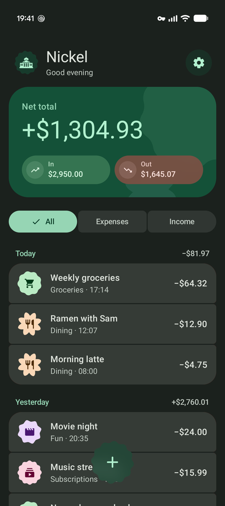
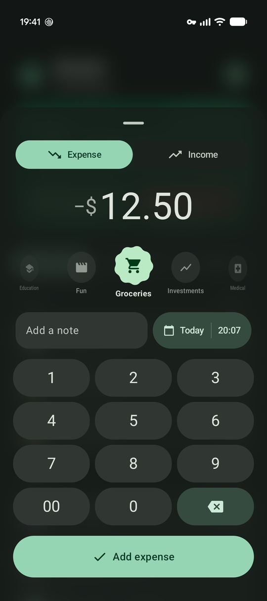
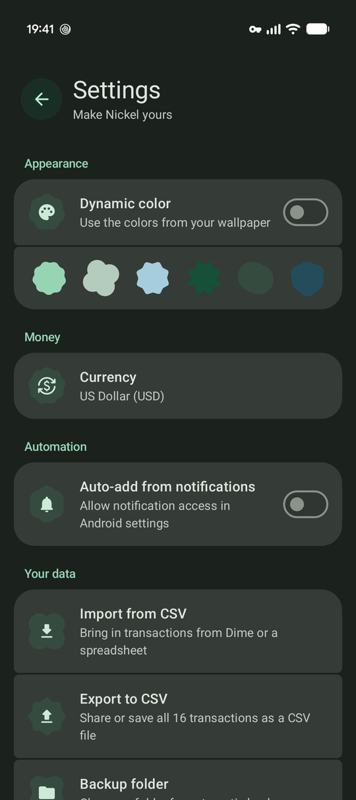
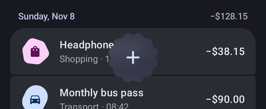

# Nickel

A cozy little expense tracker for Android, built with Jetpack Compose and
[Material 3 Expressive](https://m3.material.io/).

<p align="center">
  
  
  
</p>

## Features

- A running total that rolls like an odometer, with history grouped by day
- Quick entry from the spinning **+**: number pad, category dial, note and date in one sheet
- Swipe a transaction right to duplicate it, left to delete it
- Frosted glass on Android 17 QPR2, with springy, shape-morphing motion throughout
- Dynamic color, or Nickel's own sage-green theme
- CSV import and export, automatic backups to a folder you pick, and home-screen widgets (overall balance and today)

<p align="center">
  
</p>

## Privacy

No internet permission. Your ledger stays on your device unless you export it.

## CSV

Exports use the same layout as [Dime](https://github.com/rafsoh/dimeApp), so files move between the two apps:

```csv
Date,Note,Amount,Category,Type
2026-10-31 14:12:45 +0000,Groceries run,42.18,Groceries,Expense
```

Imports match columns by header name, so most spreadsheets work as long as they
have a date and an amount. You get a preview before anything is saved, and
transactions you already have are skipped.

## Building

Needs the Android SDK with platform 37.2 and a device on Android 17 or newer.

```sh
./gradlew installDebug      # build and install on a connected device
./gradlew testDebugUnitTest # run the unit tests
```

## License

[MIT](LICENSE)
